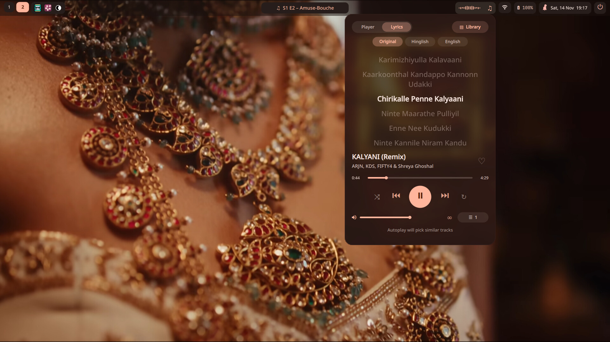

# betterCachy

My CachyOS + Hyprland desktop setup: configs, theme pipeline, Quickshell bar, and a
Matugen-powered SDDM login theme.

> See [`ARCHITECTURE.md`](ARCHITECTURE.md) for what every piece does and how the
> theming pipeline is wired together.

## What it's for and who it's suitable for

This repository is a **Hyprland + Quickshell + Matugen** desktop setup for CachyOS / Arch
Linux. It is a dotfiles + theme-pipeline repo: restore the config into `$HOME`, then
regenerate a coherent colour palette from any wallpaper. Everything colour-related is
generated by **Matugen** and can also sync to the SDDM greeter.

**Use it if:**
- you move to (or consolidate onto) CachyOS / Arch Linux with Hyprland and want a single
  `install.sh` to restore your desktop config;
- you want a coherent colour scheme across GTK, Qt, Hyprland, Quickshell, Kvantum and the
  SDDM greeter, generated from one wallpaper via **Matugen**;
- you prefer a Quickshell bar + `vicinae` launcher + `swayosd` OSD over the default
  CachyOS stack;
- you want to customise your shell and restore everything else (with backups) using `install.sh`.

**It is not** a ready-made ISO or a "one-command-from-scratch" desktop. You still need a
working CachyOS/Arch + Hyprland base, packages, and you must run `theme-apply` afterwards
to generate the colour palette from your chosen wallpaper.

## Who it's suitable for

- someone moving to (or consolidating onto) CachyOS / Arch Linux with Hyprland;
- someone who wants a single, repeatable way to move their desktop config to a new machine
  (and back up an old one);
- someone comfortable running `pacman`, `paru`/`yay`, `flatpak`, `systemctl --user` and
  `chsh`;
- someone who prefers a **fish** default shell (the repo also ships `zsh`, `bash` and
  editors not in use).

## Screenshot



## What's inside

| Area | Files | Notes |
| --- | --- | --- |
| Shell & git | `.bashrc`, `.bash_profile`, `.bash_logout`, `.zshrc`, `.p10k.zsh`, `.gitconfig` | zsh + powerlevel10k, Fish is installed separately |
| GTK | `.gtkrc-2.0`, `home/.config/gtk-3.0/`, `home/.config/gtk-4.0/` | `adw-gtk3-dark` + Noctalia overrides, generated by `theme-apply` |
| Hyprland | `home/.config/hypr/` | `hyprland.lua`, `hyprland-settings.lua` (UI-generated), `hyprpaper`, `hyprlock`, `hypridle` |
| Quickshell | `home/.config/quickshell/` | Wayland bar + OSD shell (`shell.qml`, `bar/`, `osd/`) |
| SDDM login theme | `home/.config/sddm-matugen/`, `system/usr/share/sddm/themes/matugen/` | Qt/QML theme source + palette + install script |
| User services | `home/.config/systemd/user/` | `quickshell.service`, `vicinae.service`, `swayosd.service` |
| Matugen | `home/.config/matugen/` | `config.toml` + `templates/` (GTK, Qt, Hypr, QtCM, SDDM) |
| Kvantum | `home/.config/Kvantum/` | `kvantum.kvconfig` + `Matugen` Kvantum theme |
| Qt colour schemes | `home/.config/qt5ct/`, `home/.config/qt6ct/` | Matugen-generated `matugen.conf` |
| Terminals & launchers | `home/.config/kitty/`, `home/.config/kando/`, `home/.config/nwg-look/` | kitty config, kando menu, nwg-look GTK |
| autostart | `home/.config/uwsm/env` | `uwsm` session environment file |
| Theming scripts | `home/.local/bin/theme-apply`, `home/.local/bin/kvantum-apply` | fish scripts, generated colour + wallpaper sync |
| Install | `install.sh` | `rsync`-based restore into `$HOME` (with backup) |
| Packages | `packages/pacman-explicit.txt`, `packages/pacman-foreign.txt`, `packages/flatpak.txt` | package manifests |
| Reference | `system/etc/sddm.conf.d/zz-matugen-theme.conf` | root-owned SDDM config snapshot |

> Everything under `home/` mirrors real paths in `$HOME`. `system/` is a read-only
> reference for root-owned files (SDDM only) and is **not** restored by `install.sh`.

Deliberately **not** included (multi-GB data or machine-local): browser profiles, caches,
SSH/GPG keys, OpenCode `service.json` (contains a password), wallpapers, and other
app-local state. Re-add extras by copying them into `home/.config/<name>/`.

## Requirements

- CachyOS / Arch Linux
- A working Hyprland session
- `git`, `rsync`

## Install (new machine)

```bash
git clone <your-repo-url> ~/Projects/betterCachy
cd ~/Projects/betterCachy
./install.sh --dry-run     # preview what will change
./install.sh               # restore into $HOME (existing files -> ~/.betterCachy-backup/<date>)
```

### 1. Packages

```bash
# Official repos (this also re-adds anything already present — harmless)
comm -23 <(sort packages/pacman-explicit.txt) \
         <(sort packages/pacman-foreign.txt) | sudo pacman -S --needed -

# AUR (needs paru or yay)
paru -S --needed - < packages/pacman-foreign.txt

# Flatpaks
flatpak install -y $(cat packages/flatpak.txt)
```

### 2. Regenerate the theme from a wallpaper

Everything colour-related is generated by Matugen. Pick a wallpaper and run the theme
script — it also syncs the SDDM login background:

```bash
theme-apply ~/Pictures/wallpaper.jpg
```

This writes `~/.config/quickshell/colors.json`, `~/.config/hypr/colors.conf`, GTK/Qt colour
files, and rebuilds the Kvantum theme. `theme-apply -l <image>` also updates the hyprlock
wallpaper.

### 3. SDDM login theme

```bash
sudo ~/.config/sddm-matugen/install.sh
```

That installs the theme to `/usr/share/sddm/themes/matugen`, selects it in
`/etc/sddm.conf.d/zz-matugen-theme.conf`, and grants the `sddm` user ACL access to the
palette and wallpaper under `~/.config/sddm-matugen/`.

### 4. User services

```bash
systemctl --user daemon-reload
systemctl --user enable --now quickshell.service vicinae.service swayosd.service
```

### 5. Shell

```bash
chsh -s /usr/bin/fish
```

## Everyday theming

```bash
theme-apply ~/Pictures/new-wallpaper.jpg     # colors + wallpaper + SDDM bg
theme-apply -l ~/Pictures/new-wallpaper.jpg  # ...and hyprlock too
```

## Restoring the old versions

Anything overwritten by `install.sh` is preserved under
`~/.betterCachy-backup/<timestamp>/` using the same relative paths, e.g.
`~/.betterCachy-backup/20261114-132000/.config/hypr/hyprland.lua`.

## Notes

- `~/.config/hypr/hyprland.lua` is a Lua Hyprland config; `hyprland-settings.lua` is
  generated by the *Hyprland Settings* panel and re-applied from there.
- Files marked as generated in `ARCHITECTURE.md` are snapshots — `theme-apply` rewrites
  them.
- The SDDM background is a copy at `~/.config/sddm-matugen/background`; the actual image
  is not committed.
- SDDM theme paths use `@@HOME@@` placeholder expanded at install time by
  `home/.config/sddm-matugen/install.sh`; fish scripts use `$HOME`. On a different
  username, re-run `./install.sh --system` to regenerate.
- `install.sh` backs up every overwritten file to `~/.betterCachy-backup/<ts>/` before
  writing; use `-y` to skip all confirmations, `--dry-run` to preview, and `--select` to
  restore a single directory instead of all of `home/`.
