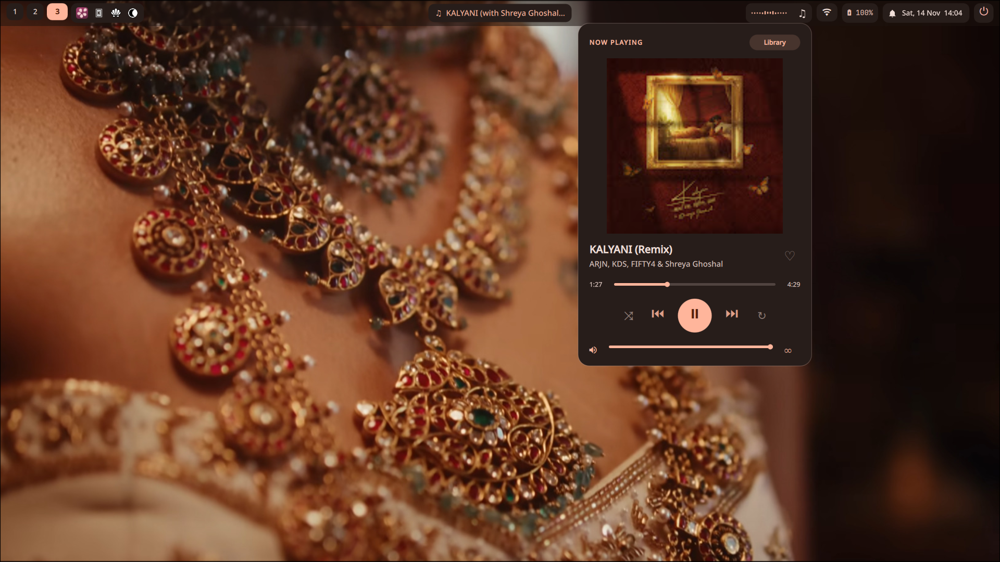

# dotfiles

My CachyOS + Hyprland desktop setup: configs, theme pipeline, Quickshell bar, and a
Matugen-powered SDDM login theme.

> See [`ARCHITECTURE.md`](ARCHITECTURE.md) for what every piece does and how the
> theming pipeline is wired together.

## Screenshot



## What's inside

| Path | Contents |
| --- | --- |
| `home/` | Files restored into `$HOME` (dotfiles + selected `~/.config/*`) |
| `system/` | Read-only reference copies of root-owned files (SDDM theme + config) |
| `packages/` | `pacman` explicit + AUR lists and Flatpak apps |
| `install.sh` | Restores `home/` into `$HOME` with a backup of anything overwritten |

Deliberately **not** included: browser profiles, caches, SSH/GPG keys, OpenCode
`service.json` (contains a password), AppImages, wallpapers, and other multi-GB
data. Re-add extra configs by copying them into `home/.config/<name>/`.

## Requirements

- CachyOS / Arch Linux
- A working Hyprland session
- `git`, `rsync`

## Install (new machine)

```bash
git clone <your-repo-url> ~/Projects/dotfiles
cd ~/Projects/dotfiles
./install.sh --dry-run     # preview
./install.sh               # restore into $HOME (existing files -> ~/.dotfiles-backup/<date>)
```

### 1. Packages

```bash
# Official repos (this also re-adds anything already present — harmless)
comm -23 <(sort packages/pacman-explicit.txt) \
         <(sort packages/pacman-foreign.txt) | sudo pacman -S --needed -

# AUR (needs paru or yay)
paru -S --needed - < packages/pacman-foreign.txt

# Flatpaks
flatpak install -y $(cat packages/flatpak.txt)
```

### 2. Regenerate the theme from a wallpaper

Everything colour-related is generated by Matugen. Pick a wallpaper and run the
theme script — it also syncs the SDDM login background:

```bash
theme-apply ~/Pictures/wallpaper.jpg
```

This writes `~/.config/quickshell/colors.json`, `~/.config/hypr/colors.conf`,
GTK/Qt colour files, and rebuilds the Kvantum theme. `theme-apply -l <image>`
also updates the hyprlock wallpaper.

### 3. SDDM login theme

```bash
sudo ~/.config/sddm-matugen/install.sh
```

That installs the theme to `/usr/share/sddm/themes/matugen`, selects it in
`/etc/sddm.conf.d/zz-matugen-theme.conf`, and grants the `sddm` user ACL access
to the palette and wallpaper under `~/.config/sddm-matugen/`.

### 4. User services

```bash
systemctl --user daemon-reload
systemctl --user enable --now quickshell.service vicinae.service swayosd.service
```

### 5. Shell

```bash
chsh -s /usr/bin/fish
```

## Everyday theming

```bash
theme-apply ~/Pictures/new-wallpaper.jpg     # colors + wallpaper + SDDM bg
theme-apply -l ~/Pictures/new-wallpaper.jpg  # ...and hyprlock too
```

## Restoring the old versions

Anything overwritten by `install.sh` is preserved under
`~/.dotfiles-backup/<timestamp>/` using the same relative paths, e.g.
`~/.dotfiles-backup/20261114-132000/.config/hypr/hyprland.lua`.

## Notes

- `~/.config/hypr/hyprland.lua` is a Lua Hyprland config; `hyprland-settings.lua`
  is generated by the *Hyprland Settings* panel and is re-applied from there.
- Files marked as generated in `ARCHITECTURE.md` are snapshots — `theme-apply`
  rewrites them.
- The SDDM background is a copy at `~/.config/sddm-matugen/background`; the
  actual image is not committed.
- Some paths are absolute (`/home/rishabh/...`) because the SDDM greeter and the
  fish scripts cannot expand `~`: `home/.config/sddm-matugen/theme/theme.conf`,
  `home/.config/matugen/config.toml`, `home/.config/sddm-matugen/install.sh`, and
  `home/.local/bin/theme-apply`. Update them if you restore under a different
  username.
